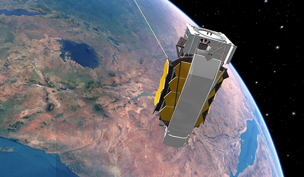
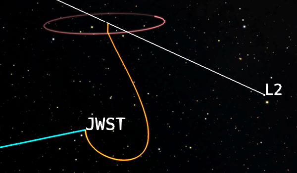
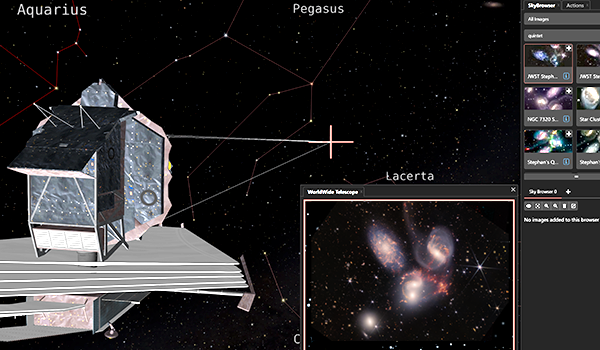

# James Webb Space Telescope

:::{attention}
This profile and its tours are currently being written. \
These pages are a work in progress and will be completed soon. \
---Eds., October 2026
:::

::::::::{tab-set}

:::::::{tab-item} Overview

## Mission Overview

The James Webb Space Telescope (JWST) is a space-based infrared observatory developed through an international partnership between NASA, the European Space Agency, and the Canadian Space Agency. It was designed to investigate the early universe, galaxy evolution, star and planet formation, and the properties of exoplanets.

:::{figure} profile_launch.png
:align: center
:alt: JWST as rendered in OpenSpace

JWST as rendered in OpenSpace.
:::

The mission originated from discussions as far back as 1989, and construction began in 2004. The project grew into one of the most ambitious astronomical observatories ever built. Its 6.5-meter-diameter primary mirror is made up of 18 individual hexagonal segments. It is roughly 2.5 times wider than Hubble's mirror and collects more than 6 times as much light. JWST's instruments required decades of scientific planning, engineering, testing, and international collaboration.

### Components of the JWST 

Besides the obvious mirrors and detectors, JWST carries many different components that perform specific roles to make the observatory work. In a sense, we can divide the telescope into a cold side and a hot side.

:::{figure} JWST_components.png
:align: center
:alt: The components of JWST

The components of JWST as seen from the so called cold side and hot side. Credit: STScI, NASA, ESA, CSA
:::

The cold side is behind the sunshield and contains all the instrumentation that needs to remain cold. The mirrors and detectors need to be under 50 Kelvin (−223.2&deg;C or −369.7&deg;F), otherwise the heat would overwhelm the infrared detectors. The components here include:

::::::{grid} 1 2 2 2

:::::{grid-item}

- Primary mirror: 18 hexagonal segments made of gold-coated beryllium. Each segment is mounted on a hexapod with actuators, which allow fine adjustments to the segment's orientation and to the radius of curvature of the overall mirror.
- Secondary mirror: A movable mirror that adjusts the focus of the light collected by the primary mirror and directs it toward the instruments.
- Tertiary and fine-steering mirrors: Additional mirrors that guide and stabilize the light on its way to the instruments.
- Integrated Science Instrument Module (ISIM): The housing for JWST's four scientific instruments:
  - Near-Infrared Camera (NIRCam)
  - Near-Infrared Spectrograph (NIRSpec)
  - Mid-Infrared Instrument (MIRI)
  - Near-Infrared Imager and Slitless Spectrograph (NIRISS)
:::::

:::::{grid-item}
:::{figure} JWST_Full_Mirror.jpg
:align: center
:alt: JWST's Primary Mirror

JWST's primary mirror assembled in 2016. Credit: NASA
:::
:::::
::::::

The hot side holds the components that power and protect the telescope.
- Sunshield: Blocks sunlight from reaching the mirrors and instruments, keeping them cold.
- Solar panels: Power the telescope.
- Momentum trim tab: Sits at one end of the telescope and balances the radiation pressure (the pressure exerted by sunlight) on the sunshield.

:::{figure} James_Webb_telescope_sunshield.jpg
:align: center
:alt: JWST's sunshield

JWST's sunshield, roughly the size of a tennis court, taken in 2014. Credit: NASA
:::

### JWST's Location in Space

JWST operates in a halo orbit around the Sun–Earth second Lagrange point, or L{sub}`2`. L{sub}`2` is approximately 1.5 million kilometers (1 million miles) from Earth, in the direction opposite the Sun. A Lagrange point is a location where the gravitational forces of two large bodies balance, creating a stable point to orbit around. At L{sub}`2`, the telescope stays aligned behind Earth as both Earth and JWST orbit the Sun while the sunshield remains facing the Sun. 

(profiles--missions--jwst--lagrange-points)=

::::{admonition} Lagrange Points
Lagrange points are five points in a two-body system (Sun and Earth, in this case) where an object will remain relatively stable in space. These points of equilibrium for a small body relative to the Sun and Earth allow spacecraft to use less fuel to operate. There are five points in the Sun-Earth system, numbered L{sub}`1`--L{sub}`5`.

:::{figure} lagrange_points.png
:align: center
:width: 80%
:figwidth: 70%
:alt: Lagrange points diagram

The five Lagrange points of the Sun-Earth system. JWST is located 1.5 million km (1 million miles) from Earth at L{sub}`2`, always on the side of Earth opposite the Sun. This image is not to scale, to see these at the proper scale, look at them in OpenSpace.
:::

Points L{sub}`1`, L{sub}`2`, and L{sub}`3` lie along a line connecting the Sun and Earth and were discovered by Leonhard Euler (1707--1783) around 1750. L{sub}`4` and L{sub}`5` were discovered by Joseph-Louis Lagrange (1736--1813) about a decade later. Lagrange wrote about the three-body problem delineating these five points in a famous 1770s paper.

Objects located at L{sub}`1`, L{sub}`2`, and L{sub}`3` are unstable, so they need to be constantly course correcting every few weeks to remain in orbit around these points. L{sub}`4` and L{sub}`5` are truly stable and lie about 60&deg; away along Earth's orbital trajectory. These harbor a couple Trojan asteroids, balanced by the gravity of the two bodies and their orbital motion.

JWST is located at L{sub}`2`, on the opposite side of Earth than the Sun. Here, Earth's gravity drags on objects located here, giving them the same orbital period around the Sun even though the orbit is a million miles farther than Earth's orbit. In addition to JWST, the Roman telescope is located at L{sub}`2` along with [WMAP](/content/universe/cosmic-microwave-background/wmap/index) and [Planck](/content/universe/cosmic-microwave-background/planck/index).

::::

### How Does JWST Differ from Hubble?

JWST was designed to complement Hubble's discoveries, not to replace them. The two observatories differ in their optical designs, wavelength coverage, operating environments, and scientific strengths.

Hubble has a 2.4-meter primary mirror and observes ultraviolet, visible, and some near-infrared light. Webb observes primarily in the infrared, revealing areas invisible to Hubble.

### Why Infrared?

Infrared is important for a number of reasons, and offers capabilities not available in the visible spectrum.

When we look at objects in the infrared, we see more sensitivity toward cooler objects and gas. Infrared pierces through {term}`astrophysical dust` to reveal stars and gas invisible to us in visible light. Cooler stars appear brighter in the infrared too.

Infrared is also valuable at cosmic distances. As the universe expands, light traveling from very distant galaxies is stretched toward longer wavelengths. This is called cosmological redshift. Light that began as ultraviolet or visible can arrive at Earth as infrared. Infrared observations can therefore detect very distant objects whose light has been stretched over billions of years.

:::{figure} JWST_EM_Spectrum.png
:align: left
:alt: Electromagnetic spectrum with the observing ranges of JWST, Hubble, and Spitzer

The electromagnetic spectrum with the observational ranges of JWST, Hubble, and Spitzer space telescopes. Credit: NASA, ESA, CSA, Joseph Olmsted (STScI)
:::

JWST was designed to advance our exploration and understanding of the universe. It will detect light from the first galaxies and provide understanding on how galaxies evolve. It will also investigate stellar and planetary evolution, and will study exoplanets for systems that may support life.

:::::::

:::::::{tab-item} Tours

## Tours

::::{grid} 1 2 2 3
:gutter: 1 1 1 2

:::{grid-item-card} JWST Deployment

Trace the path of JWST from launch to its destination in space as the telescope is deployed for first light.

+++
[Take Tour »](./tour-deployment/index)
:::

:::{grid-item-card} JWST Orbit and Location

JWST is 1.5 million kilometers from Earth. Explore the location and orbit of JWST, and see why it's so far from Earth.

+++
[Take Tour »](./tour-orbit/index)
:::

:::{grid-item-card} JWST Image Tour

Point the JWST telescope at the images it's taken using the SkyBrowser and Worldwide Telescope's image library.

+++
[Take Tour »](./tour-images/index)
:::

::::

% This profile visualizes the NASA-ESA-CAN James Webb Space Telescope, which launched on December 25, 2021. The profile includes two visualizations of the Webb trail: One plotted with respect to the Earth-Sun L2, where it will be stationed; and another with respect to the Sun, as we plot the orbits of the planets. The profile includes a dynamic model of Webb and a time lapse of its deployment and unfolding. The profile includes the capability to point the telescope with an associated view frustum to any celestial coordinates. The orientation can be controlled by entering Right Ascension (R.A.) and Declination (Dec.) on an [external webpage](http://ui.openspaceproject.com/jwst_scripts).

:::::::

:::::::{tab-item} Data Sets

## Data Sets

%  "assets": [
% "scene/solarsystem/planets/earth/earth",
% "scene/solarsystem/planets/earth/layers/colorlayers/viirs_noaa20_temporal.asset",
% "scene/solarsystem/planets/earth/satellites/satellites",
% "scene/solarsystem/planets/earth/satellites/misc/hubble_trail",
% "scene/solarsystem/planets/earth/lagrange_points/lagrange_points",
% "scene/solarsystem/telescopes/jwst/jwst",
% "scene/solarsystem/telescopes/jwst/trail",
% "scene/solarsystem/telescopes/jwst/targets/targets",
% "scene/solarsystem/telescopes/jwst/timelapse",
% "scene/solarsystem/telescopes/jwst/toggle_trail",
% "scene/solarsystem/telescopes/jwst/point_jwst",
% "scene/digitaluniverse/hdf"

### Solar System
:::{warning}
This section is missing some data sets. Mostly planet moons and satellites whose documentation has not yet been written.
:::

#### Sun
::::{grid} 1 2 3 4
:gutter: 1 1 1 2

:::{grid-item-card} 

:::

:::{grid-item-card} 

:::

:::{grid-item-card} 

:::

::::

#### Planets
::::{grid} 1 2 3 4
:gutter: 1 1 1 2

:::{grid-item-card} 

:::

:::{grid-item-card} 

:::

:::{grid-item-card} 

:::

:::{grid-item-card} 

:::

:::{grid-item-card} 

:::

:::{grid-item-card} 

:::

:::{grid-item-card} 

:::

:::{grid-item-card} 

:::

::::

#### Dwarf Planets
::::{grid} 1 2 3 4
:gutter: 1 1 1 2

:::{grid-item-card} 

:::

::::

#### Comets
::::{grid} 1 2 3 4
:gutter: 1 1 1 2

:::{grid-item-card} 

:::

::::

### Milky Way
#### Stars
::::{grid} 1 2 3 4
:gutter: 1 1 1 2

:::{grid-item-card} 

:::

:::{grid-item-card} 

:::

:::{grid-item-card} 

:::

:::{grid-item-card} [Distance Uncertainty](/content/milky-way/stars/star-distance-uncertainty/index)

:::

:::{grid-item-card} 

:::

:::{grid-item-card} 

:::

::::

#### Constellations
::::{grid} 1 2 3 4
:gutter: 1 1 1 2

:::{grid-item-card} [Lines](/content/milky-way/constellations/constellation-lines/index)

:::

:::{grid-item-card} [Art](/content/milky-way/constellations/constellation-art/index)

:::

:::{grid-item-card} [Boundaries](/content/milky-way/constellations/constellation-boundaries/index)

:::

::::

#### All-sky Images
::::{grid} 1 2 3 4
:gutter: 1 1 1 2

:::{grid-item-card} [Hydrogen-alpha](/content/milky-way/all-sky-images/hydrogen-alpha/index)

:::

:::{grid-item-card} [Visible](/content/milky-way/all-sky-images/visible-milky-way/index)

:::

::::

#### Substellar Objects
::::{grid} 1 2 3 4
:gutter: 1 1 1 2

:::{grid-item-card} 

:::

::::

#### Exoplanets
::::{grid} 1 2 3 4
:gutter: 1 1 1 2

:::{grid-item-card} 

:::

:::{grid-item-card} 

:::

::::

#### Star Clusters
::::{grid} 1 2 3 4
:gutter: 1 1 1 2

:::{grid-item-card} 

:::

:::{grid-item-card} 

:::

:::{grid-item-card} 

:::

::::

#### Nebulae
::::{grid} 1 2 3 4
:gutter: 1 1 1 2

:::{grid-item-card} 

:::

:::{grid-item-card} 

:::

:::{grid-item-card} 

:::

::::

#### Stellar Remnants
::::{grid} 1 2 3 4
:gutter: 1 1 1 2

:::{grid-item-card} 

:::

:::{grid-item-card} 

:::

::::

#### Galaxy
::::{grid} 1 2 3 4
:gutter: 1 1 1 2

:::{grid-item-card} [Image](/content/milky-way/galaxy/milky-way-image/index)

:::

:::{grid-item-card} [Volume](/content/milky-way/galaxy/milky-way-volume/index)

:::

:::{grid-item-card} [Arm Labels](/content/milky-way/galaxy/milky-way-arm-labels/index)

:::

::::

#### Graphics
::::{grid} 1 2 3 4
:gutter: 1 1 1 2

:::{grid-item-card} 

:::

::::

### Universe
#### Nearby Surveys
::::{grid} 1 2 3 4
:gutter: 1 1 1 2

:::{grid-item-card} 

:::

:::{grid-item-card} 

:::

:::{grid-item-card} 

:::

:::{grid-item-card} 

:::

:::{grid-item-card} 

:::

:::{grid-item-card} 

:::

:::{grid-item-card} 

:::

:::{grid-item-card} 

:::

:::{grid-item-card} 

:::

::::

#### Deep-sky Surveys
::::{grid} 1 2 3 4
:gutter: 1 1 1 2

:::{grid-item-card} 

:::

:::{grid-item-card} 

:::

:::{grid-item-card} 

:::

:::{grid-item-card} 

:::

:::{grid-item-card} 

:::

::::

#### Cosmic Microwave Background
::::{grid} 1 2 3 4
:gutter: 1 1 1 2

:::{grid-item-card} 

:::

:::{grid-item-card} 

:::

:::{grid-item-card} 

:::

::::

:::::::

:::::::{tab-item} Dossier

## Dossier

:::{list-table}
:header-rows: 0
:stub-columns: 1
:align: left
:width: 90%

  - - Name:
    - James Webb Space Telescope
  - - File:
    - `data/profiles/jwst.profile`
  - - Anchor:
    - JWST Model
  - - Time:
    - 2021-12-25, 12:50:01
  - - Author:
    - OpenSpace Team
  - - License:
    - [MIT](https://github.com/OpenSpace/OpenSpace/blob/master/LICENSE.md)
  - - Version:
    - 1.2
:::

:::::::

::::::::

:::{toctree}
:maxdepth: 1
:hidden:

tour-deployment/index
tour-orbit/index
tour-images/index
:::