# Tour: JWST Deployment

::::::{grid} 1 2 2 2

:::::{grid-item}
This tour takes you though the launch and deployment of the observatory. We effectively replay the mission landmarks that occurred between launch and first light.

This includes following JWST from Earth to its destination orbit around the Earth-Sun Lagrange point 2 (L{sub}`2`), and the unfurling of the spacecraft's sunshield and mirror. All of this is animated in realtime as it happened in the mission. Finally, we end the tour with first light and first science images, six months after launch.

:::::

:::::{grid-item}
:::{important}

{.no-bullet}
  - {octicon}`rocket;1.25em;profile-tour-action` : Flight instructions
  - {octicon}`diff-added;1.25em;profile-tour-action` : Turn on a data set
  - {octicon}`diff-removed;1.25em;profile-tour-action` : Turn off a data set
  - {octicon}`tools;1.25em;profile-tour-action` : Adjust a setting
  - {octicon}`telescope;1.25em;profile-tour-action` :  Target an object
  - {octicon}`stopwatch;1.25em;profile-tour-action` : Change the time settings

:::
:::::
::::::

The figure below shows the overall mission milestones that were necessary to execute before first light. Its 30-day journey out to L{sub}`2` was a harrowing process of deployment of the spacecraft's components, alignment of the mirrors, and testing of the instruments. Any one of hundreds of processes could have hampered the mission, but everything performed flawlessly.

:::{figure} JWSTDeployment.jpg
:align: center
:alt: JWST deployment schedule

The JWST launch timeline and deployment schedule. From launch, it took about 30 days to reach its orbit around L{sub}`2`. Along the way, the sun shield, antenna, and mirrors of the telescope were deployed.
:::

## Mission Panel

::::::{grid} 1 2 2 2

:::::{grid-item}
This tour can be used with the Mission Panel. In the JWST Profile, the Mission Panel automatically shows JWST's milestones from launch to its first deep field image six months later. 

Each milestone has a brief description, and an accompanying image if one is available.

Rather than wait for the time to advance to each milestone, you can click a milestone's {menuselection}`Set time` button in the Mission Panel to automatically set the time in OpenSpace to the time of that milestone. This allows you to page through each milestone while advancing OpenSpace to that time of the mission.

:::::

:::::{grid-item}

:::{figure} jwst_mission_panel.png
:align: left
:alt: OpenSpace's Mission Panel for JWST

The Mission Panel showing the JWST milestones. Here, we see the milestone for January 23, 2022, when it arrived and was inserted into it's orbit around Lagrange point 2. Use the interactive timeline to explore milestones, and the {menuselection}`Set time` button to go to that time in OpenSpace.
:::

:::::
::::::

:::{admonition} Pretour Checklist
- **Start the tour** by launching OpenSpace with the {menuselection}`JWST` profile.
- {octicon}`tools;1.25em;profile-tour-action` Open the Mission Panel with the {w=25px} button.
- {octicon}`diff-removed;1.25em;profile-tour-action` {menuselection}`Scene --> Solar System --> Telescopes --> JWST --> JWST Safe Viewing Band`
- {octicon}`diff-removed;1.25em;profile-tour-action` {menuselection}`Scene --> Solar System --> Telescopes --> JWST --> JWST Field of View`
- {octicon}`diff-removed;1.25em;profile-tour-action` {menuselection}`Scene --> Solar System --> Planets --> Earth --> Lagrange Points --> Sun to L2 Line`

:::

## Launch

{.tutorial}
- {octicon}`telescope;1.25em;profile-tour-action` Target JWST in the [Navigation Panel](/using-openspace/toolbar/navigation/index) using JWST's target button {w=20px}
- {octicon}`stopwatch;1.25em;profile-tour-action` {menuselection}`Action --> JWST --> Deployment Timelapse --> Set to JWST launch time`
- {octicon}`rocket;1.25em;profile-tour-action` Fly to JWST manually or by using a transition in the Navigation Panel: {w=20px} or {w=20px}

[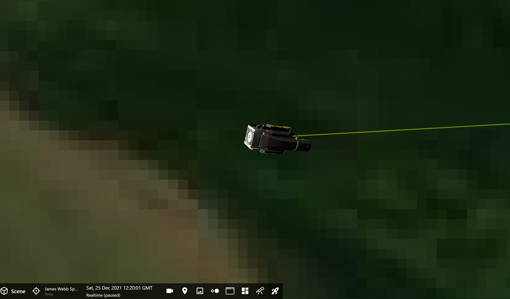](launch_plus_0.png)

We begin our tour on launch day, December 25, 2021.

When you fly up to JWST a few things will be immediately obvious. One, **we are not rendering a rocket**. You will see a model of JWST and can follow along as it's launched into space, but you'll have to use your imagination that a rocket is taking it there. 

Two, the **Earth terrain is severely pixelated**. This is done intentionally because the launch site in French Guiana is censored for security reasons. All maps will show this area as blurred.

{.tutorial}
- {octicon}`tools;1.25em;profile-tour-action` Click the December 2021 Launch Milestone in the Mission Panel timeline.

[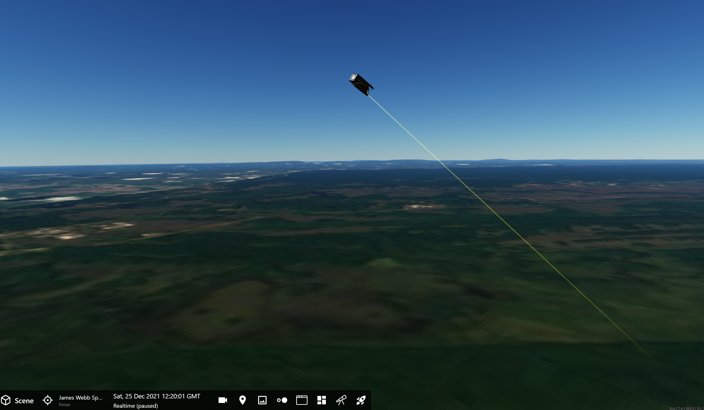](launch_plus_0_side.png)

{.tutorial}
- {octicon}`stopwatch;1.25em;profile-tour-action` Unpause time
- {octicon}`rocket;1.25em;profile-tour-action` Fly away and orbit around JWST to get a better view

[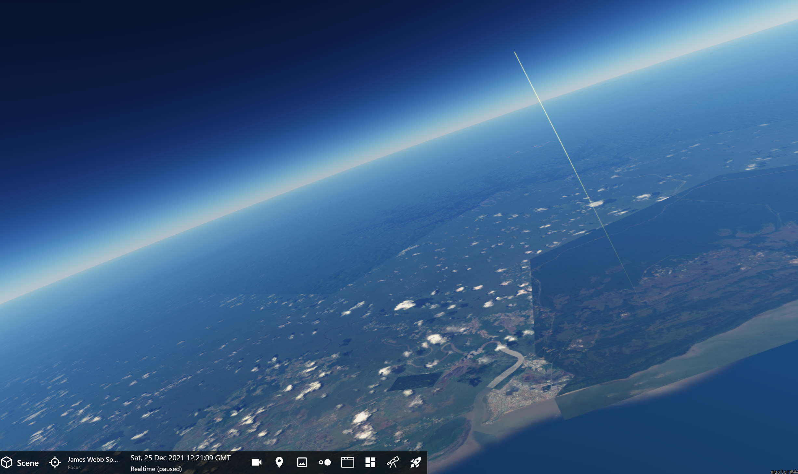](launch_plus_1m.png)

{.tutorial}
- {octicon}`rocket;1.25em;profile-tour-action` Fly closer to get a sense you're riding along with the telescope as it passes over Earth

[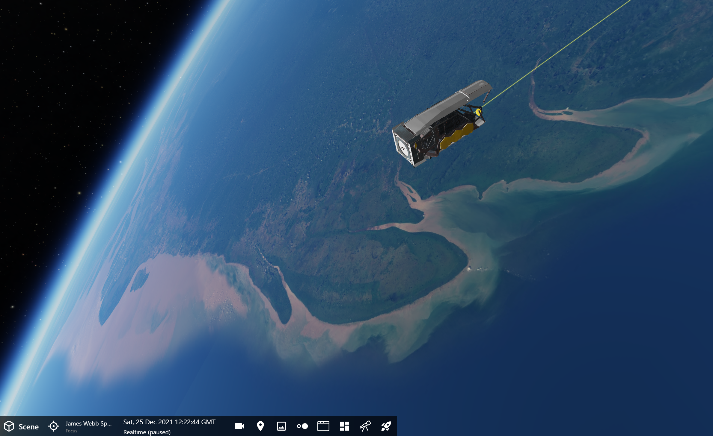](launch_plus_2m.png)

{.tutorial}
- {octicon}`stopwatch;1.25em;profile-tour-action` Use the Quick Adjust slider in the [Time Panel](/using-openspace/toolbar/time/index) to move time forward if you like. You can also use the {kbd}`Space` bar to pause and resume time.

[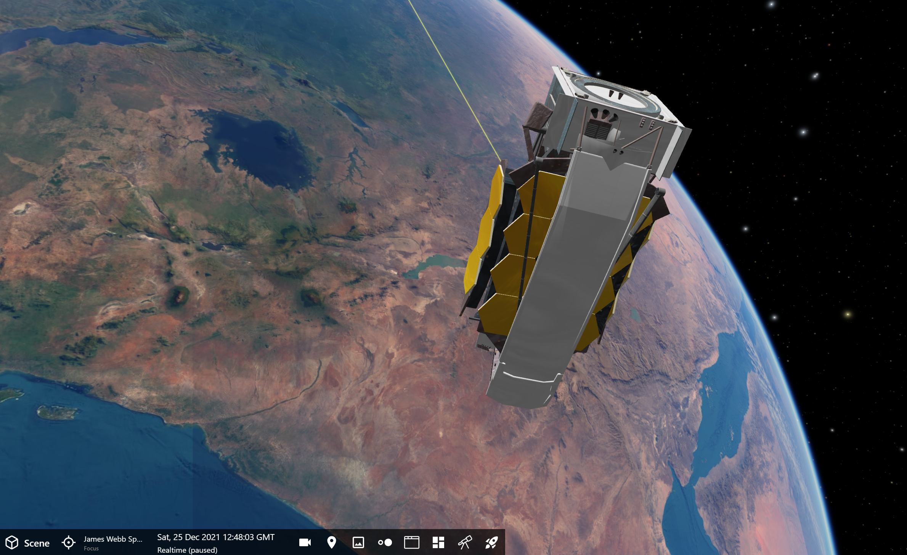](launch_plus_27m.png)

At 27 minutes after launch, picured above, the telescope separated from the rocket's upper stage and began its journey toward L{sub}`2`. It will take about 30 days to get there.

About 12 hours after launch, the telescope's rockets began firing for 65 minutes to put it in a trajectory toward the L{sub}`2` point one million miles away.

## Sun Shield Deployment

[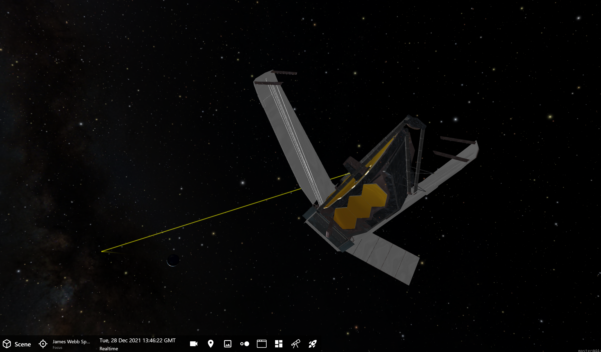](launch_plus_3d.png)

Three days after the launch, engineers began to unfurl the telescope's sun shield. This will protect the mirror and detectors from the Sun's light and heat. 

[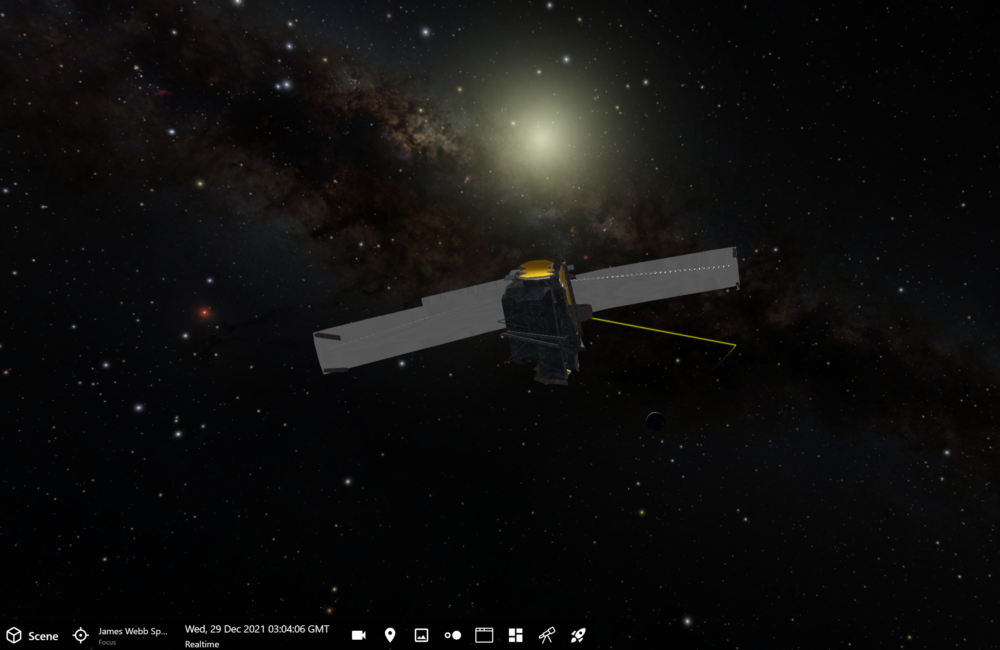](launch_plus_4d.png)

It took several days to fully deploy the sun shield.

[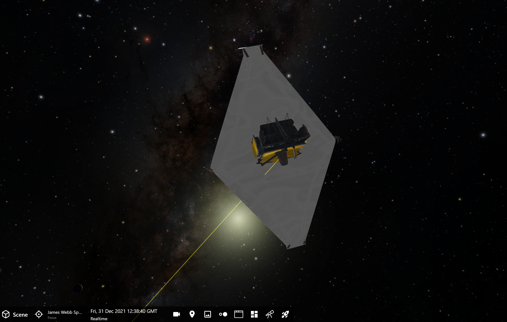](launch_plus_6d.png)

[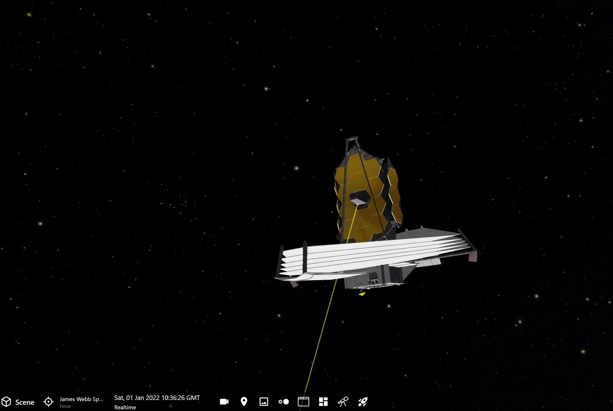](launch_plus_7d.png)

## Secondary Mirror

After deploying the two mid booms, each taking over 3 hours to move into place, the secondary mirror was lowered on January 5, 2022.

The primary mirror's wings, still partially folded below, were rotated into place on January 7 and 8, 2022. In this screenshot, one side is rotated into place, while the other side will be rotated on January 8.

[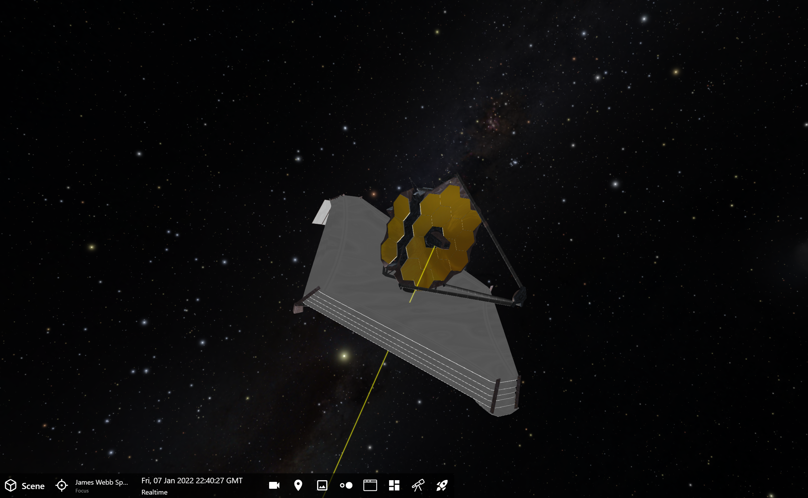](launch_plus_13d.png)

## On Its Way to L{sub}`2`

{.tutorial}
- {octicon}`diff-added;1.25em;profile-tour-action` {menuselection}`Scene --> Solar System --> Planets --> Earth --> Lagrange Points --> Sun to L2 Line`
- {octicon}`rocket;1.25em;profile-tour-action` Continue to move around JWST at varying distance to gain perspective on the trajectory toward L{sub}`2`

[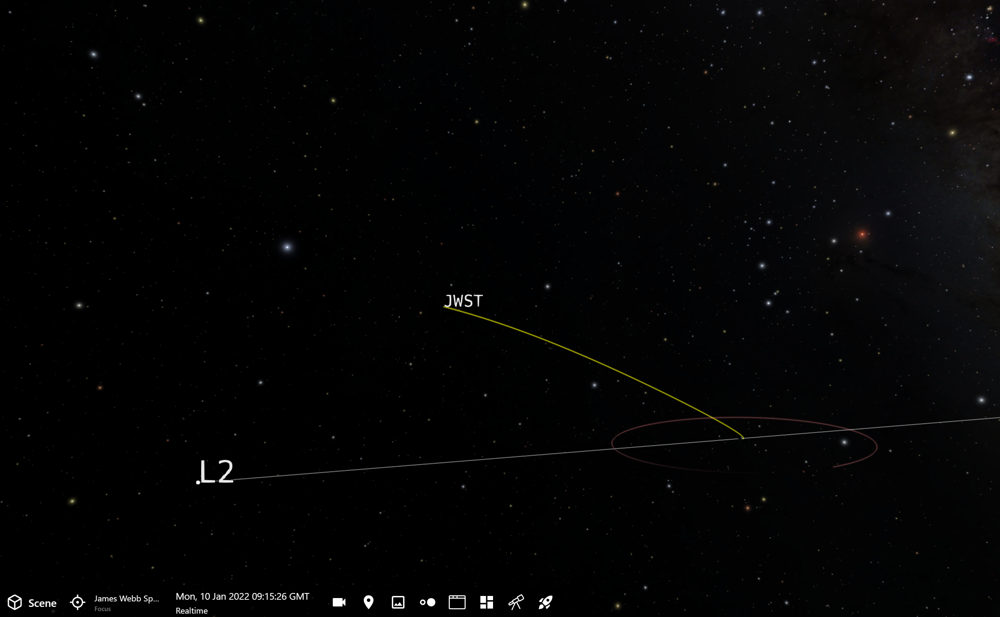](launch_plus_16d_line.png)

JWST takes about 30 days from launch to when it enters its orbit around Lagrange point 2 (L{sub}`2`).

## Entering Its Orbit Around L{sub}`2`

{.tutorial}
- {octicon}`tools;1.25em;profile-tour-action` Click the January 2022 Arrival at L{sub}`2` Orbit Milestone in the Mission Panel timeline.

[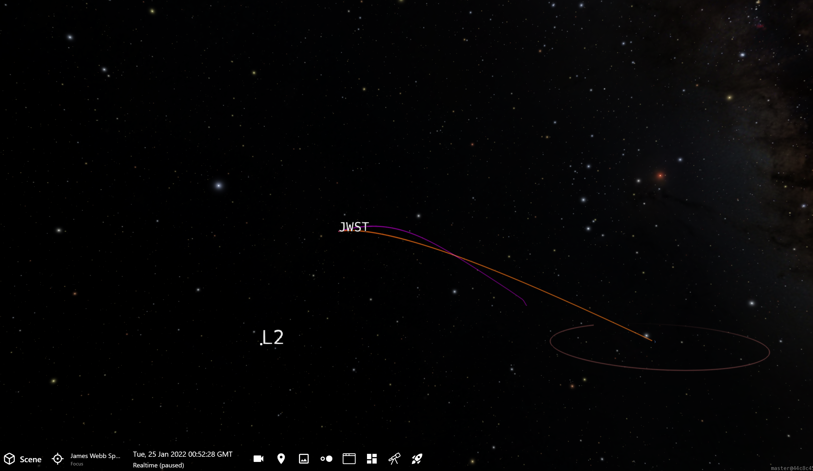](launch_plus_31d.png)

On January 24 19:00 UT, JWST's rockets fired their third course correction in order to insert the telescope in orbit around the L{sub}`2` point. 

Here, the trajectory from the Earth-L{sub}`2`'s perspective becomes orange, and there is a purple trail that shows the telescope's trajectory from L{sub}`2`'s point of view.

## First Light

{.tutorial}
- {octicon}`tools;1.25em;profile-tour-action` Click the February 2022 "NIRCam Detected the First Photons" Milestone in the Mission Panel timeline.

[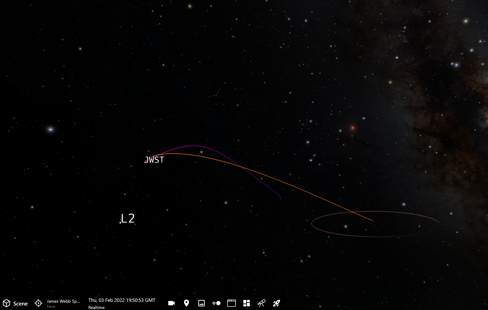](launch_plus_40d.png)

Once the sun shield was deployed, it took weeks for the mirror and instruments to cool down sufficiently. When the mirror reached -153&deg;C (-244&deg;F or 120 Kelvin), the arduous process of aligning the mirrors could begin.

On February 3, 2022, first light occurred on JWST. Photons were detected, though a coherent image would require further mirror alignment.

## First Image & Mirror Alignment

{.tutorial}
- {octicon}`tools;1.25em;profile-tour-action` Click on the March 2022 First Phasing Alignment Milestone in the Mission Panel timeline
  
[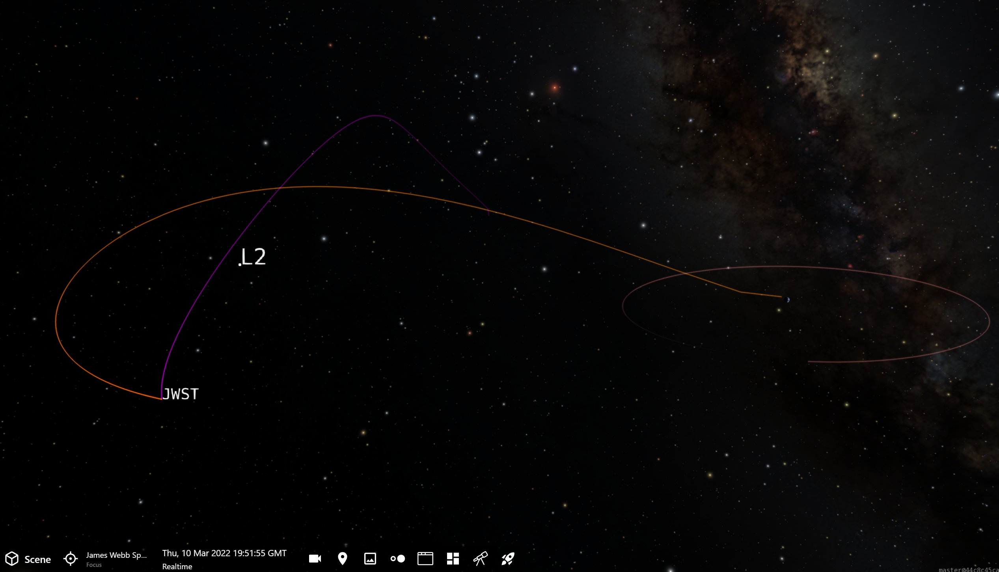](launch_plus_75d.png)

Mirror alignment took about a month, but once it was complete the telescope acted as one mirror instead of 18 individual mirrors. The star HD 84406 in the constellation Ursa Major was the first target and was used to align the mirrors.

{.tutorial}
- {octicon}`tools;1.25em;profile-tour-action` Click on the April 2022 "Alignment Complete" Milestone in the Mission Panel timeline
  
[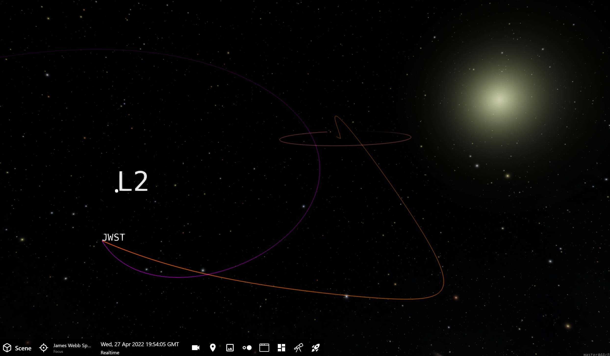](launch_plus_123d.png)

Mirror alignment was completed on April 24, 2022.

## First Deep Field Image Released

{.tutorial}
- {octicon}`tools;1.25em;profile-tour-action` Click on the July 2022 "First Deep Field Image Released" Milestone in the Mission Panel timeline

The first deep field image, releasd on July 11, 2022, was of a 4.6-billion-light-year distant cluster of galaxies called Stephan's Quintet. We will explore this more in the [JWST Images Tour](../tour-images/index).

### Two Orbits, Same Moment

Here, we show where JWST was on July 11, 2022. However, we render two different orbits. The first is the orbit from Earth-L{sub}`2`'s co-rotating perspective, which shows the trajectory from Earth out to the location of the spacecraft in its orbit around L{sub}`2`.

[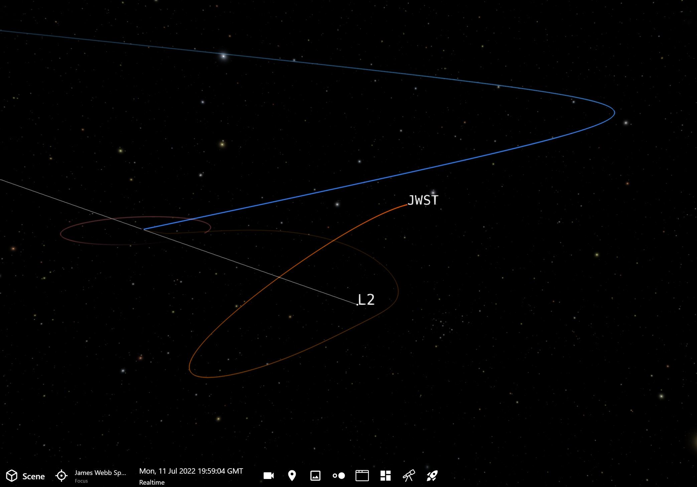](launch_plus_198d_earth_orbit.png)

This next image shows JWST's orbit from the perspective of someone at the L{sub}`2` point. 

[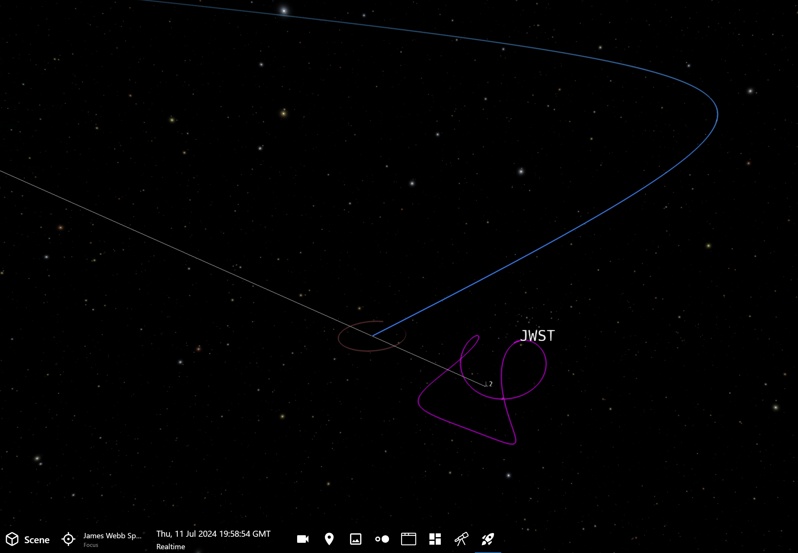](launch_plus_198d_L2_orbit.png)

The telescope does not sit in one stable position at L{sub}`2`, it actually is in orbit around that point. And, its orbit is not stable, so JWST must do periodic corrections to maintain its orbit around L{sub}`2`.

## Conclusion

In the end, hundreds of operations had to perform flawlessly in order for JWST to live up the high engineering standards that were built into it. With six month of calibrations, it was a painstaking operation to be sure everything was working to spec so that the mission was deemed a success. From shipping it from California to South America through the Panama Canal, to the hundreds of deployment steps and release mechanisms, JWST will capture our imagination and advance the scientific frontier in ways we have yet to envision.
