# Tour: JWST Images with SkyBrowser

::::::{grid} 1 2 2 2

:::::{grid-item}
This tour will show you how to use OpenSpace's SkyBrowser to see JWST images. You've undoubtedly seen some of its images in your web browser, but with the SkyBrowser we can view its images in the context of the night sky via [Worldwide Telescope](https://worldwidetelescope.org/). This allows us to view an image while also seeing where the telescope is pointing in the sky.

In this tour we will use the SkyBrowser to explore some of the first images released by JWST in the summer of 2022.
:::::

:::::{grid-item}
:::{important}

{.no-bullet}
  - {octicon}`rocket;1.25em;profile-tour-action` : Flight instructions
  - {octicon}`diff-added;1.25em;profile-tour-action` : Turn on a data set
  - {octicon}`diff-removed;1.25em;profile-tour-action` : Turn off a data set
  - {octicon}`tools;1.25em;profile-tour-action` : Adjust a setting
  - {octicon}`telescope;1.25em;profile-tour-action` :  Target an object
  - {octicon}`stopwatch;1.25em;profile-tour-action` : Change the time settings

:::
:::::
::::::

:::{seealso}
OpenSpace's SkyBrowser is a fundamental part of this tour. Please see  to review how to use the SkyBrowser before taking this tour.
:::

:::{admonition} Pretour Checklist
- **Start the tour** by launching OpenSpace with the {menuselection}`JWST` profile.
- {octicon}`tools;1.25em;profile-tour-action` Close the Mission Panel
- {octicon}`diff-added;1.25em;profile-tour-action` Turn on JWST's Field of View {menuselection}`Actions --> JWST --> Field of view (toggle)`

[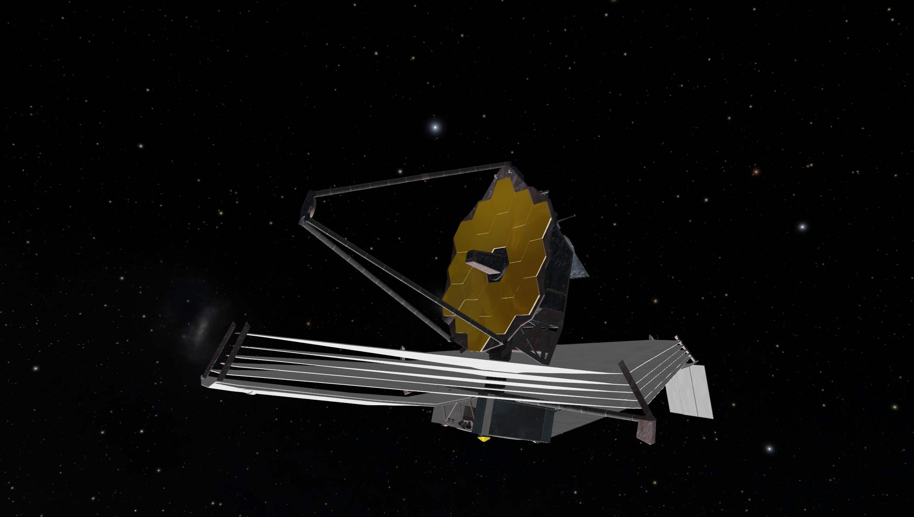](profile_launch.png)
:::

## Launch the SkyBrowser

{.tutorial}
- {octicon}`tools;1.25em;profile-tour-action` Launch a SkyBrowser with the {w=30px}.

[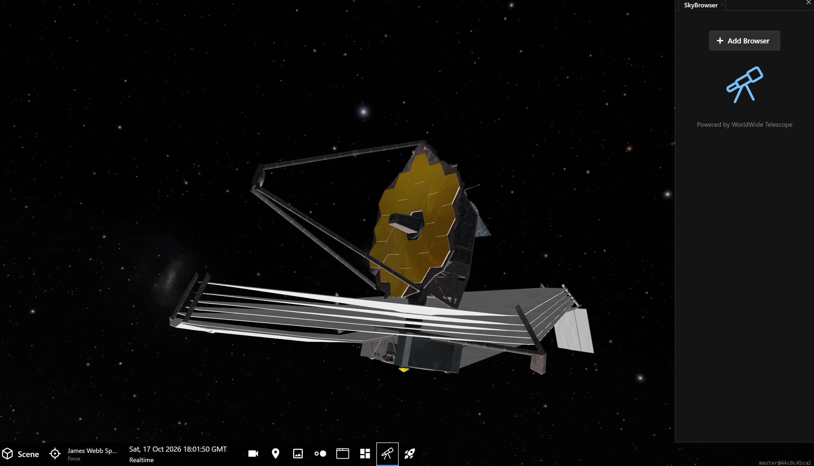](jwst_add_skybrowser.png)

{.tutorial}
- {octicon}`tools;1.25em;profile-tour-action` Press the {menuselection}`Add Browser` button.

This will create a SkyBrowser named *SkyBrowser 0* in the lower half of the panel. You will also see:
- The target (the red + in the image below).
- The field of view (the red box surrounding the red +).
- The SkyBrowser window titled "Worldwide Telescope."
- A list of images in the top of the SkyBrowser Panel.

[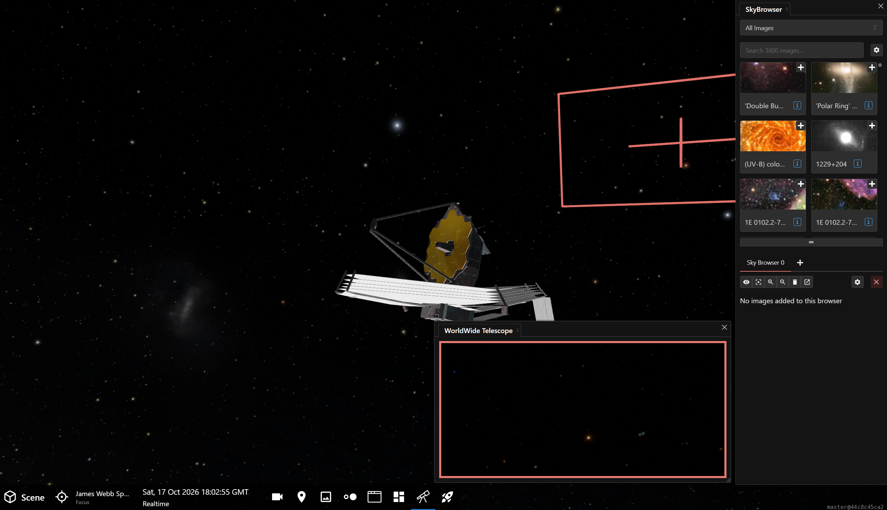](jwst_new_browser.png)

:::{note}
Your SkyBrowser accent color may be different. OpenSpace chooses from a variety of colors to distinguish between different SkyBrowsers.
:::

{.tutorial}
- {octicon}`tools;1.25em;profile-tour-action` Open SkyBrowser 0's settings using the {w=25px} button.
- {octicon}`tools;1.25em;profile-tour-action` In the SkyBrowser 0's settings, check the {menuselection}`Point Spacecraft` option on.

[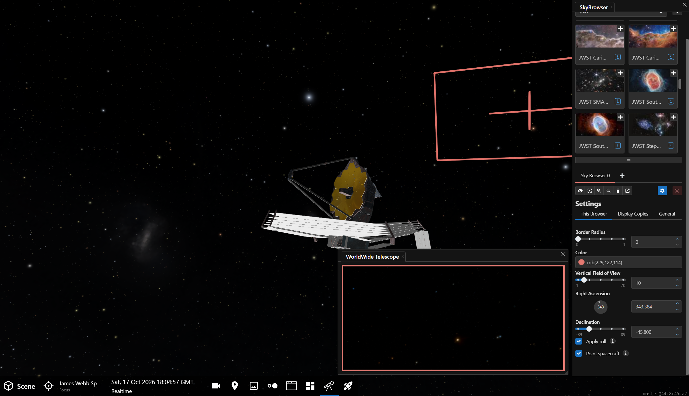](jwst_skybrowser_settings.png)

Turning on the {menuselection}`Point Spacecraft` option connects JWST to SkyBrowser 0 so when an image is added to SkyBrowser 0, the telescope will point to its location in the sky.

{.tutorial}
- {octicon}`tools;1.25em;profile-tour-action` Close SkyBrowser 0's settings using the {w=25px} button.

:::{note}
When the spacecraft points to a target, you may see a warning about the target coordinate violating JWST's sunshield.

This refers to a region of the sky that JWST would be prohibited from obseriving *on that date and time*. The Sun must always be on the opposite side of the mirror. In OpenSpace, you can turn on {menuselection}`Scene --> Solar System --> Telescopes --> JWST --> JWST Safe Viewing Band`, which shows those parts of the sky that are safe for observations.

If you set the time in OpenSpace to the date and time of the image you want to view in the SkyBrowser, you will not see this warning. But, if you simply choose images in the SkyBroswer, you will be doing so in OpenSpace's current time. Choosing an image in the SkyBrowser does not change the time in OpenSpace to that image's timestamp.

This warning does not materially affect your OpenSpace session.
:::

Now, let's explore some of the early images released by JWST using the SkyBrowser and WorldWide Telescope's image library.

## SMACS 0723

The first image released by JWST was of the distant galaxy cluster called SMACS 0723. That's actually a shortened name, its full ID is SMACS J0723.3–7327. SMACS stands for the Southern Massive Cluster Survey, which looked at large clusters of galaxies in 2001.

{.tutorial}
- {octicon}`tools;1.25em;profile-tour-action` Search for "SMACS" in the SkyBrowser's search box.
- {octicon}`diff-added;1.25em;profile-tour-action` Choose the image titled "Hubble RELI..."

Choosing an image will add it to the SkyBroser list below, and because we checked the {menuselection}`Point Spacecraft` in the SkyBrowser's settings, it will point JWST to its location in the sky.

{.tutorial}
- {octicon}`tools;1.25em;profile-tour-action` Set the Opacity to zero in the "Hubble RELI..." settings in the SkyBrowser.

By sliding the Opacity to the left, the image will be completely transparent, allowing us to see the default all-sky image. This image only shows a handful of foregraound stars, and there is no trace of the galaxies.

[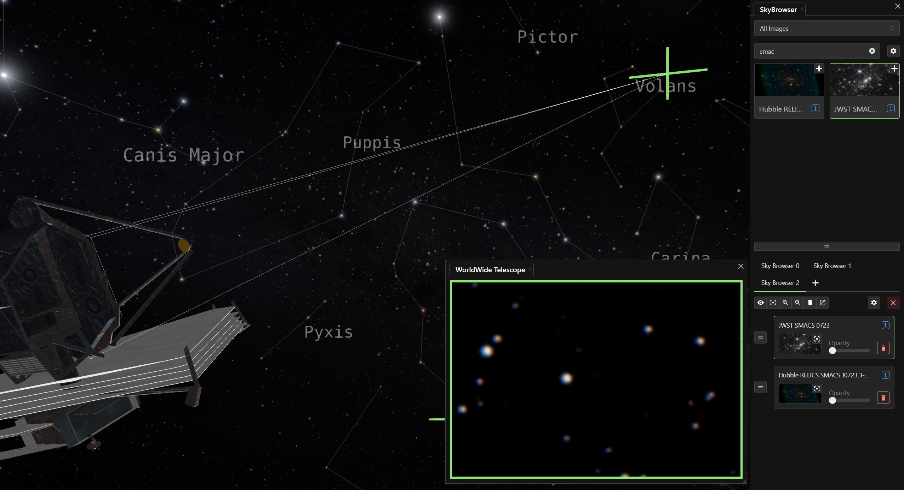](smacs_default.png)

{.tutorial}
- {octicon}`tools;1.25em;profile-tour-action` Set the Opacity to 1 in the "Hubble RELI..." settings in the SkyBrowser by moving the slider to the right.

The Hubble Space Telescope (HST) looked at SMACS 0723 in 2017 and we have that image as our first overlay. Having made the image visible with the Opacity, we can zoom into the image to reveal the lensed galaxies from the distant cluster. The cluster is 4 billion light years away.

{.tutorial}
- {octicon}`rocket;1.25em;profile-tour-action` Zoom into the image with the mouse wheel, scroll around the image with the left button in the overlaid SkyBrowser Window.

[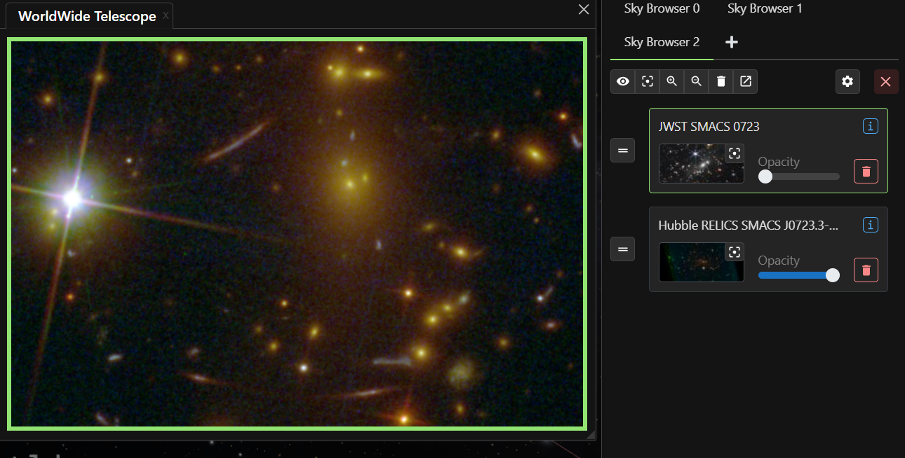](smacs_hst.png)

{.tutorial}
- {octicon}`diff-added;1.25em;profile-tour-action` Choose the image "JWST SMAC..." from the image list in the SkyBrowser Panel.

The JWST iamge will be inserted into your current SkyBrowser at the top of the list and will overlay the Hubble image.

In 2022, SMACS 0723 was unveiled as the first color image from JWST. Captured with JWST's near-infrared camera, NIRCam, it was the most detailed view of the lensed cluster to date. The circular arcs of light are the galaxies from behind the gravitaional lens, appearing to encircle the center of the image. 

[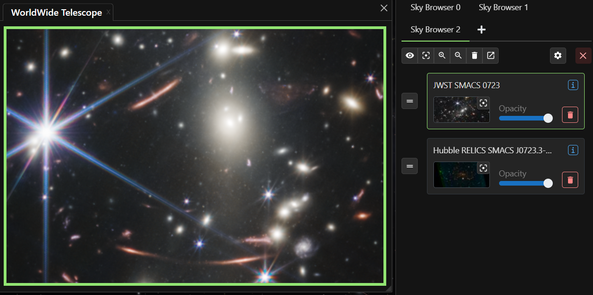](smacs_jwst.png)

## Southern Ring Nebula

Another early JWST image released was that of the Southern Ring Nebula, or NGC 3132. This is a [planetary nebula](/content/milky-way/nebulae/planetary-nebulae/index) in the constellation Vela, seen in the southern hemisphere's sky.

The misnomed planetary nebulae have nothing to do with planets. They represent the dying stages of a mid mass star. Our Sun will eventually throw off its outer layers and they will form a planetary nebula billions of years from now.

We will looks at four different JWST images of this planetary nebula.

{.tutorial}
- {octicon}`tools;1.25em;profile-tour-action` Remove both images from the SkyBrowser by pressing the trashcan button {w=20px}
- {octicon}`tools;1.25em;profile-tour-action` Search for "Southern Ring" in the image list.
- {octicon}`diff-added;1.25em;profile-tour-action` Choose the image 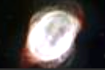{w=60px} "Southern Ring Nebula's (NIRCam and MIRI Composite Compass Image)"

Upon choosing the image, the telescope will slew over to the location of the Southern Ring Nebula and the image will be added to Skybrowser 0's list. Let's see the underlying image of the nebula in the all-sky image first though.

{.tutorial}
- {octicon}`tools;1.25em;profile-tour-action` Slide the opacity to zero for the newly added image to see the all-sky underneath.

The default image from the all-sky image shows a white, featureless blob.

[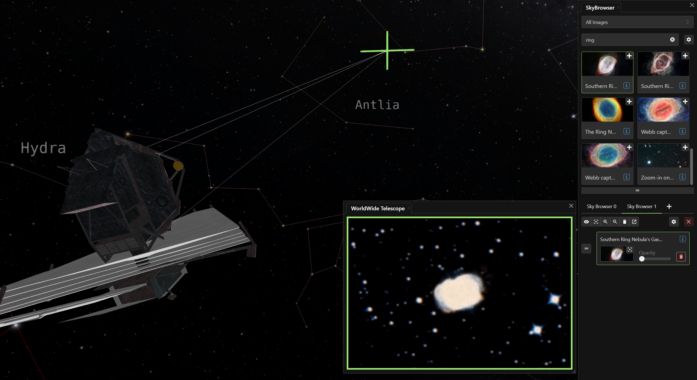](southern_ring_neb_context.png)

{.tutorial}
- {octicon}`tools;1.25em;profile-tour-action` Slide the opacity to the max to see the newly added JWST image.

This first image (top, left panel in the below figure), released in Decemner 2022, is a composite image of the NIRCam and MIRI images at various wavelengths such that the gas inside the inner bubble is revealed.

{.tutorial}
- {octicon}`diff-added;1.25em;profile-tour-action` Add the image 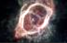{w=60px} "Southern Ring Nebula's Spokes (NIRCam and MIRI Composite Compass Image)" to the SkyBrowser.

The second image (top, right panel below), captured at the same time, is also a composite image but taken at wavelengths that delineate the structure of the outer ring more clearly.

[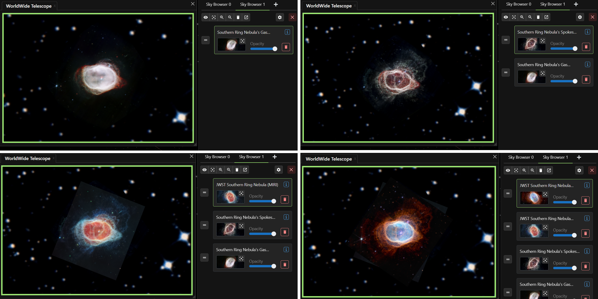](southern_ring_nebula_skybrowser_steps.png)

{.tutorial}
- {octicon}`diff-added;1.25em;profile-tour-action` Add the image 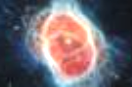{w=60px} "JWST Southern Ring Nebula MIRI" to the SkyBrowser.

This third image (bottom, left panel in the figure above) is a MIRI (Mid-Infrared Instrument) image and shows the two central stars more clearly. One of those stars, the dimmer of the two central stars, has ejected its outer layers of gas for thousands of years, resulting in the nebula. The brighter star will one day do the same, creating another planetary nebula here.

{.tutorial}
- {octicon}`diff-added;1.25em;profile-tour-action` Add the image 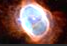{w=60px} "JWST Southern Ring Nebula NIRCam" to the SkyBrowser.

The final image (bottom, right panel) was taken with the NIRCam using the near-infrared filters. Near infrared is next to visible light in the electromagnetic spectrum and allows us to see through some of the cool gas and dust. It is also more sensitive to cooler light, so the cooler stars will shine more brightly in this image.

::::::::{tip}

::::::{grid} 1 2 2 2

:::::{grid-item}
Once you have more than one image displayed in the SkyBrowser list, you can adjust the order of the list and opacity of each image to hide or reveal layers. 

Drag {w=25px} beside an image to reorder it within the image list. Images at the top of the list are the top layer of the SkyBrowser window.

Use the Opacity slider to reveal an image in the SkyBrowser window.

In a presentation, you can preload all your images, reorder them according to how you intend to show them, then bring them up one at a time using the opacity slider, starting at the bottom of the list and working your way up to the top layer.
:::::

:::::{grid-item}
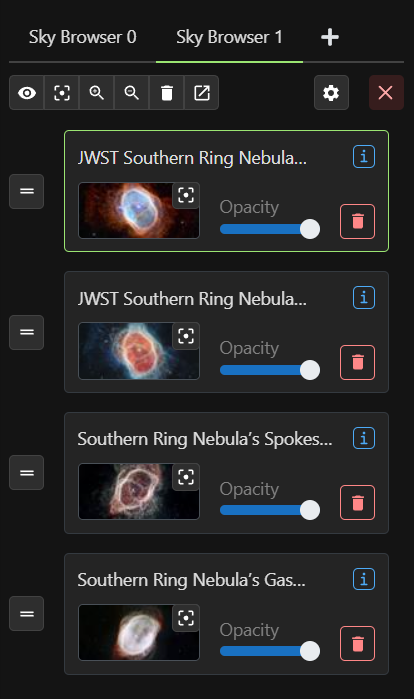
:::::
::::::
::::::::

You can, of course, use the middle mouse wheel to zoom into an image.

[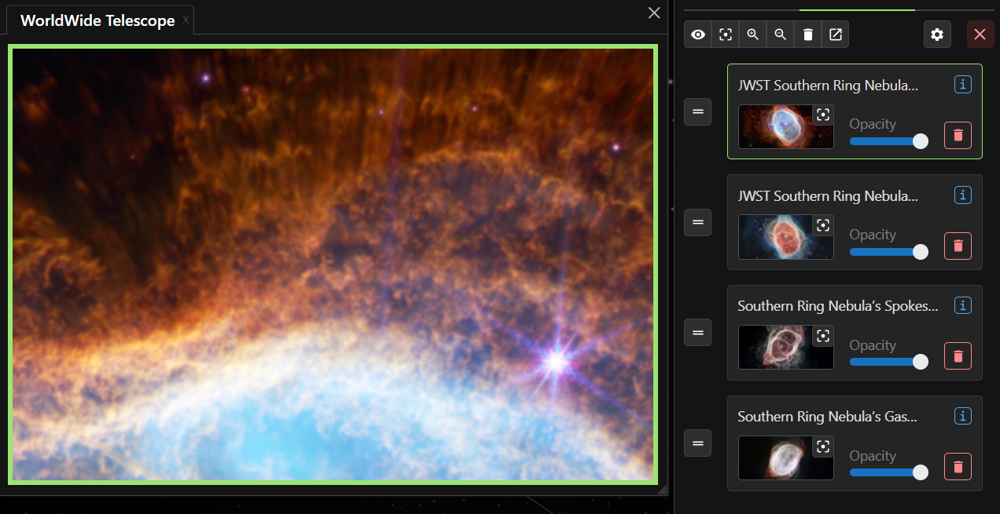](southern_ring_nebula_detail.png)

## Stephan's Quintet

Stephan's Quintet was the first compact galaxy group discovered in 1877. Located in the constellation Pegasus about 290 million light years away, four of the five galaxies seen are part of the compact cluster. Over time these four galaxies will merge with one another, but for now there are streams of gas flowing between them and a host of dwarf galaxies, all suggesting these galaxies are interacting with one another.

{.tutorial}
- {octicon}`tools;1.25em;profile-tour-action` Remove all the images from the SkyBrowser by pressing the trashcan button {w=20px}
- {octicon}`tools;1.25em;profile-tour-action` Search for "Stephan" in the image list.

[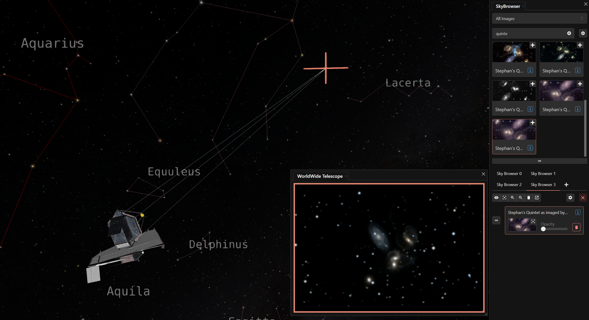](stephans_quintet_context.png)

For this target, let's preload all our images first, then view them one-by-one. From the image list, load the following images in the reverse order of the following figure, bottom image fiest.

:::{figure} stephans_quintet_image_list.png
:align: center
:width: 40%
:figwidth: 100%
:alt: Stephan's Quintet image list in SkyBrowser

The ordered image list for Stephan's Quintet in OpenSpace's SkyBrowser.
:::

{.tutorial}
- {octicon}`diff-added;1.25em;profile-tour-action` Add the images from the above figure, starting with the bottom image and working your way up to the top of the list.

The first image will reorient the telescope to point at the quintet of galaxies.

{.tutorial}
- {octicon}`tools;1.25em;profile-tour-action` Set the opacity to zero for each image in the SkyBrowser.

Now we have five images plus the default all-sky image of the qunitet. The figure below shows these six views.

The top, left panel is the all-sky background. It is the lowest quality because it is from the all-sky image, designed to take the entire sky at a lower resolution than a targeted object.

{.tutorial}
- {octicon}`tools;1.25em;profile-tour-action` Set the opacity of the lowest image in the SkyBrowser to 100%.

The top, right panel is from 2004 and was taken with the 8.1-meter Gemini North Telescope in Hawai'i. From this image it is clear that the central two galaxies are interacting with one another. The galaxy to the top, left is a foreground galaxy, not in the compact cluster.

[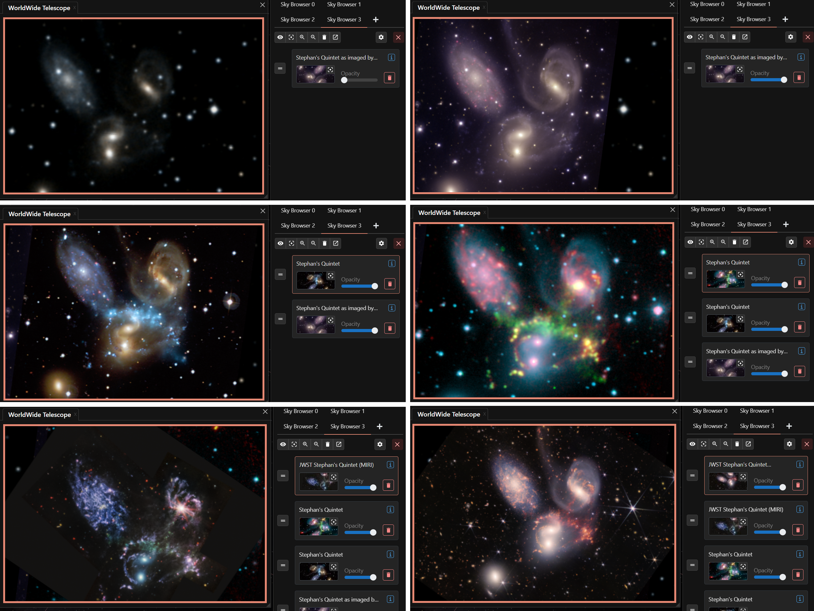](stephans_quintet_skybrowser_steps.png)

{.tutorial}
- {octicon}`tools;1.25em;profile-tour-action` Set the opacity of the next image (second from bottom in the list) to 100%.

The middle, left image is a composite of optical and X-ray light. The optical is from the Canada-France-Hawai'i Telescope. The X-ray image was taken with the Chandra X-ray Observatory. The blue arc of glowing gas is the X-ray component, resulting from the heating of the gas by a shockwave driven by the colliding galaxies at center. Stephan's Quintet was one of the first compact groups to be detected in X-ray light in the early 1980s.

{.tutorial}
- {octicon}`tools;1.25em;profile-tour-action` Set the opacity of the next image to 100%.

The middle, right panel shows this glowing shockwave in more detail (in green). This image is composed of three data sets. From the Calar Alto Observatory in Spain there is the near-infrared light (blue) and visible light called [H-alpha](/content/milky-way/all-sky-images/hydrogen-alpha/index) (green), and from the Spitzer Space Telescope there is the 8-micron infrared light (red).

{.tutorial}
- {octicon}`tools;1.25em;profile-tour-action` Set the opacity of the next image to 100%.

The bottom, left panel is from JWST's MIRI interument. Using several filters in the mid infrared, JWST's MIRI can see through the {term}`dust <Astrophysical dust>` to see how the galaxies are interacting.

{.tutorial}
- {octicon}`tools;1.25em;profile-tour-action` Set the opacity of the topmost image in the list to 100%.

The bottom, right panel is a composite of MIRI and NIRCam images from JWST. It's the largest, most detailed image of the quintet. Here we see the burst of star formation in the colliding galaxies at center, while the dust has been stripped from its neighbor galaxy. The foreground galaxy is about 40 million light years away.

## Carina Nebula

The Carina Nebula is a humungous [star-forming region](/content/milky-way/nebulae/HII-regions/index). Visible from the Southern Hemisphere, it is about 8,500 light years away and, yet, it covers four times the sky area of the Orion Nebula, which is only 1,300 light years away.

The nebula contains the Carina OB1 assocation of stars and numerous open clusters of stars. Powering the whole system, if you will, is the star Eta Carinae, a hypergiant over 100 times the mass of the Sun and 4 million times more luminous.

{.tutorial}
- {octicon}`tools;1.25em;profile-tour-action` Remove all the images from the SkyBrowser by pressing the trashcan button {w=20px}
- {octicon}`tools;1.25em;profile-tour-action` Search for "carina nebula" in the image list.
- {octicon}`diff-added;1.25em;profile-tour-action` Add the images from the above figure, starting with the bottom image and working your way up to the top of the list.

[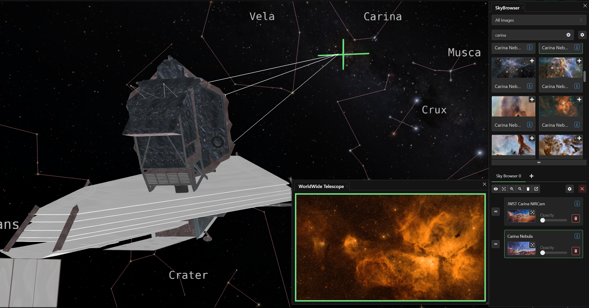](carina_nebula_context.png)

Hubble and JWST looked at one small part of the nebula, where the open star cluster NGC 3324 and the nebula IC 2599 are located. Seen as a tiny, blue strip in the image below, we can zoom into that strip in the SkyBrowser.

[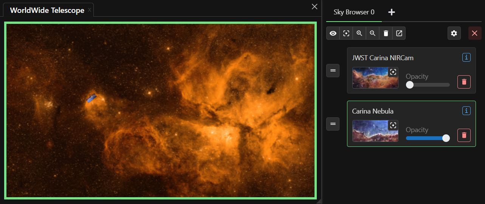](carina_nebula_image_location.png)

{.tutorial}
- {octicon}`diff-added;1.25em;profile-tour-action` Add the Carina Nebula image seen at the bottom of the list in the figure above.
- {octicon}`rocket;1.25em;profile-tour-action` Zoom out with the mouse wheel to see the whole nebula.

Now, zoom back into the image you just loaded in the SkyBrowser.

{.tutorial}
- {octicon}`tools;1.25em;profile-tour-action` Select the image in the SkyBrowser 0 image list to recenter on the image, adjust your "magnification" to your preferences.

The Hubble Space Telescope image was a highly detailed view of the boundary of a gaseous cavity carved out by the ultraviolet radiation from the nearby stars, the brightest of which are beyond this image. The blue gas is glowing from these stars, and the darker regions are cooler gas superimposed on the hot gas below it. The radiation from these stars shapes these walls that surround the hot, gaseous bubble.

[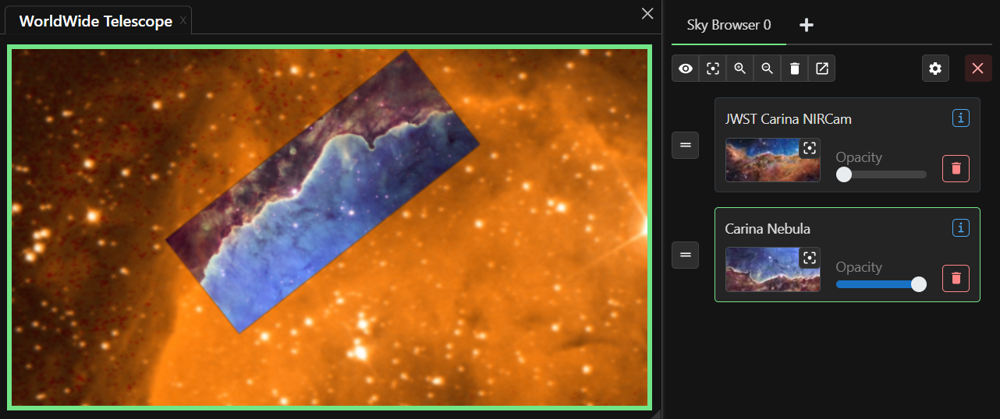](carina_nebula_hst.png)

{.tutorial}
- {octicon}`diff-added;1.25em;profile-tour-action` Add the "JWST Carina NIRCam" image seen at the top of the list in tne figure.

The JWST image was designed to overlap with the Hubble image and brings new detail to this cosmic cliff. With its infrared cameras, the JWST image reveals stars and sees through the cosmic dust to see things that were invible to Hubble.

[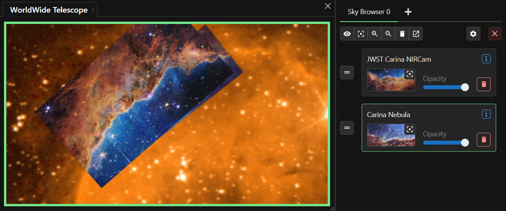](carina_nebula_jwst.png)

## Conclusion

We offer several techniques you can use to see images from JWST in the context of the night sky. From adding images one-by-one, to adding a list and adjusting their display properties one-by-one, it's fairly easy to explore an object at many wavelengths and from different telescopes. Try entering "JWST" in the image search box and explore the plenitude of Webb images in Worldwide Telescope.