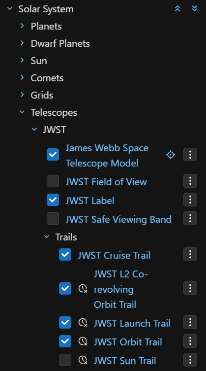
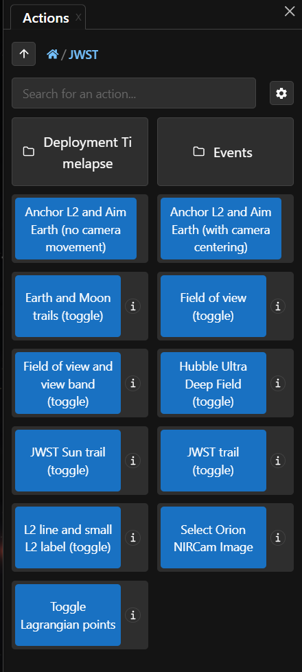
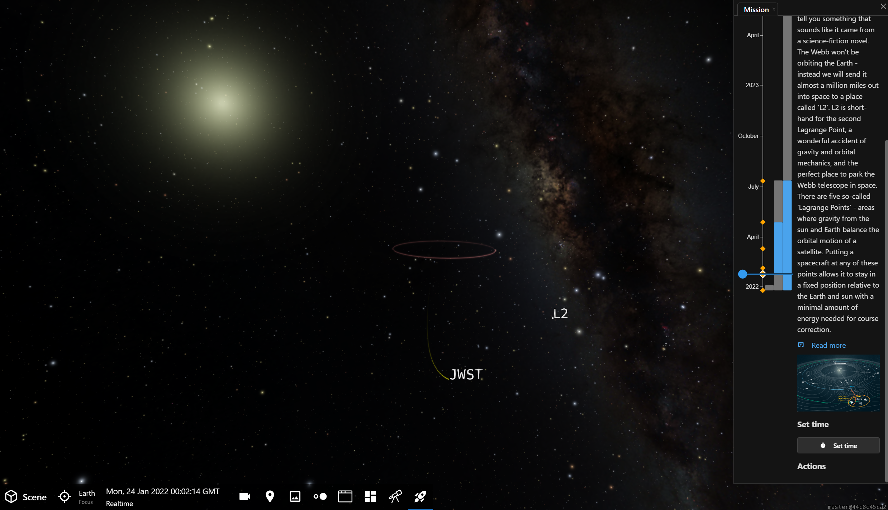
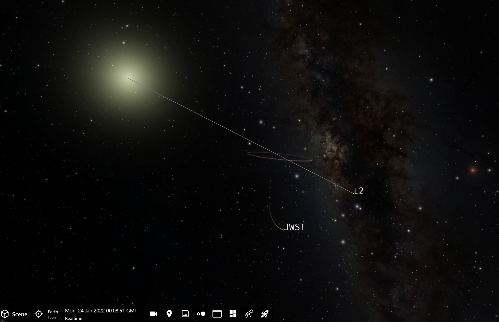
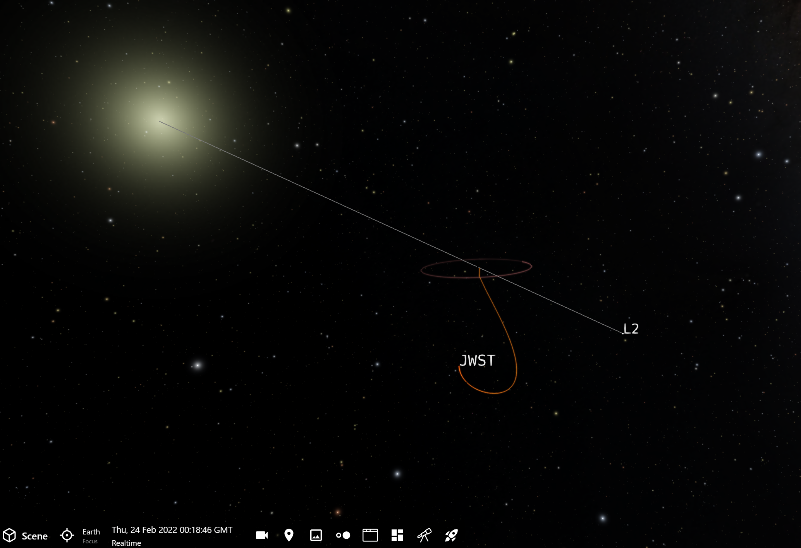
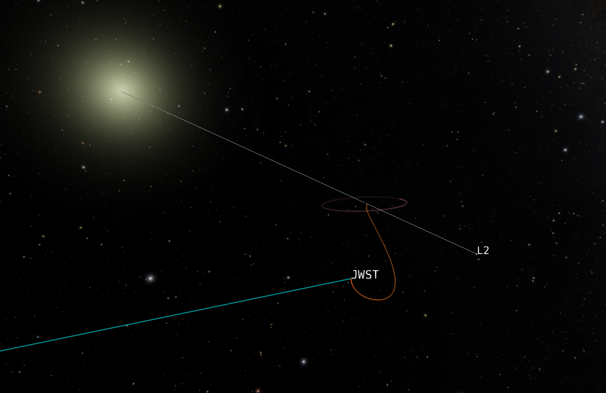
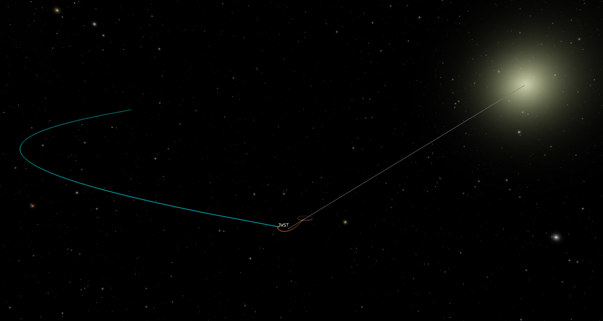
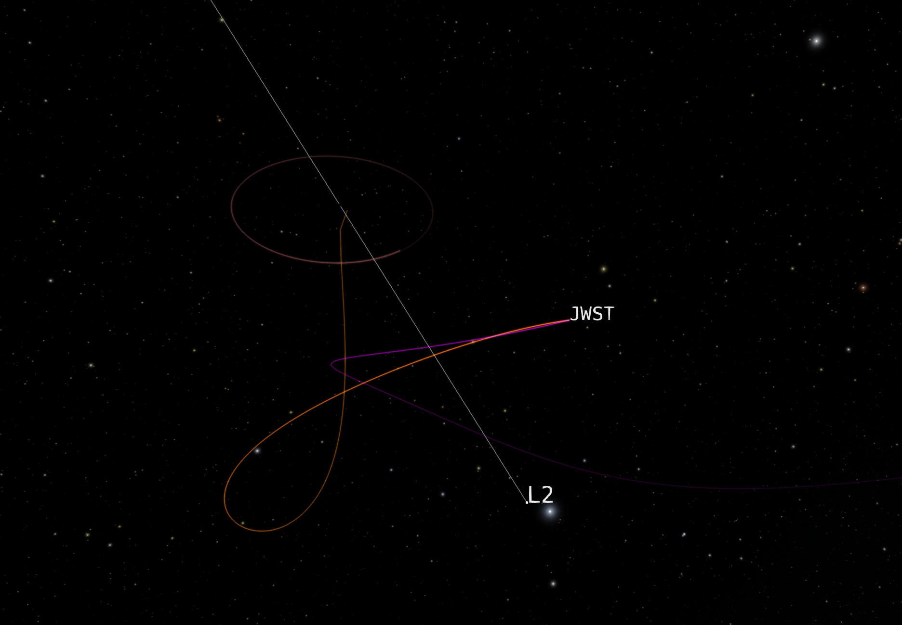
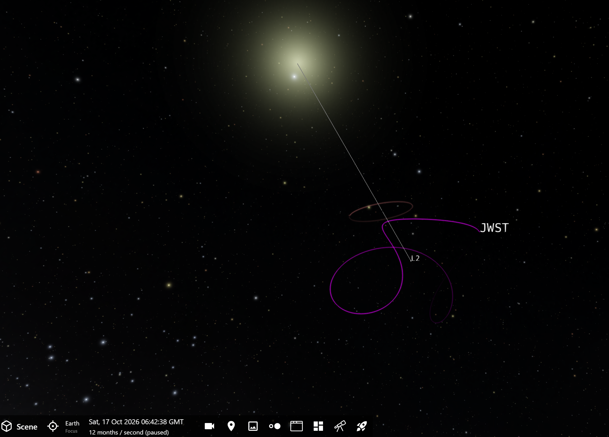
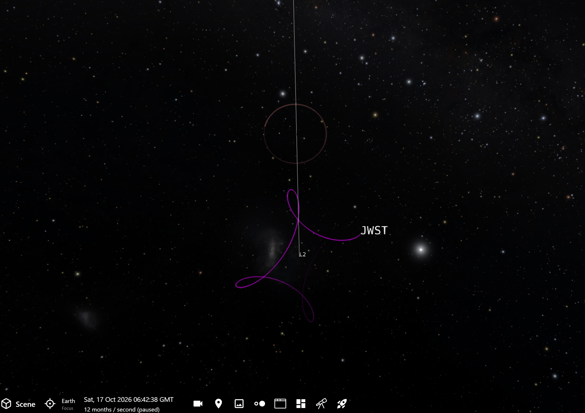

# Tour: JWST Location & Orbit

::::::{grid} 1 2 2 2

:::::{grid-item}
This tour reveals JWST's location and orbital dynamics. JWST is 1.5 million km (one million miles) from Earth and, like Earth, orbits the Sun. But, it is also in orbit around an invisible point in space. What is this point and why is it special? How long does JWST take to orbit around this point? And, is it in a stable orbit?

We will explore these questions and JWST's orbital paths from various points of view to understand how JWST moves through space.
:::::

:::::{grid-item}
:::{important}

{.no-bullet}
  - {octicon}`rocket;1.25em;profile-tour-action` : Flight instructions
  - {octicon}`diff-added;1.25em;profile-tour-action` : Turn on a data set
  - {octicon}`diff-removed;1.25em;profile-tour-action` : Turn off a data set
  - {octicon}`tools;1.25em;profile-tour-action` : Adjust a setting
  - {octicon}`telescope;1.25em;profile-tour-action` :  Target an object
  - {octicon}`stopwatch;1.25em;profile-tour-action` : Change the time settings

:::
:::::
::::::

:::{tip}
This tour refers to Lagrange points. Find out more about them in the Lagrange Points box on the [Mission Overview](profiles--missions--jwst--lagrange-points) page for JWST.
:::

This tour uses combinations of buttons and settings in the Scene Panel (below, left) and the Actions Panel (below, right). The clock icon beside some of the trails indicate that they are set to work at specific time ranges. If there is an &times; on the clock, that means time is out of that trail's time range. 

Toggle buttons in the Actions Panel will turn objects on and off, but it does not know state. For example, if you press the {menuselection}`Earth and Moon Trail (toggle)` button, you will see the trails appear (assuming they weren't already on). If, then, you go into the Scene Panel and turn off Earth's trail {menuselection}`Scene --> Solar System --> Planets --> Earth --> Earth Trail`, the Actions Panel's toggle button will be out of phase: pressing it now will turn off the Moon's trail, but turn on the Earth's trail.

::::::{grid} 1 2 2 2

:::::{grid-item}

:::::

:::::{grid-item}

:::::
::::::

:::{admonition} Pretour Checklist
- **Start the tour** by launching OpenSpace with the {menuselection}`JWST` profile.
- {octicon}`tools;1.25em;profile-tour-action` Press the January 23, 2022 milestone *Arrival at L2 Orbit* on the Mission Panel timeline. 
- {octicon}`stopwatch;1.25em;profile-tour-action` Press the {menuselection}`Set Time` button at the bottom of the milestone's description to set OpenSpace to that date and time.
- {octicon}`tools;1.25em;profile-tour-action` Close the Mission Panel
  

:::

## Arrival at L{sub}`2` Orbit Insertion

- {octicon}`diff-added;1.25em;profile-tour-action` Turn on the Earth and Moon's orbits {menuselection}`Actions --> JWST --> Earth and Moon Trails (toggle)`
- {octicon}`rocket;1.25em;profile-tour-action` Fly away from JWST to see the Earth and lunar orbit
- {octicon}`diff-added;1.25em;profile-tour-action` Turn off Earth's orbit {menuselection}`Scene --> Solar System --> Planets --> Earth --> Earth Trail`
- {octicon}`diff-added;1.25em;profile-tour-action` Turn on the Sun to L{sub}`2` Line {menuselection}`Actions --> JWST --> L2 Line and Small L2 Label (toggle)`

On January 23, 2022, JWST performed its last burn to position it into orbit around the L{sub}`2` point. L{sub}`2` is about 1.5 million km (1 million miles) from Earth, and it took one month to reach this point.

Turning on the Sun-Earth-L{sub}`2` line shows us where the L{sub}`2` point is relative to Earth. Around four times farther than the orbit of the Moon, L{sub}`2` is a stable Lagrange point where several telescopes exist, including Roman, [WMAP](/content/universe/cosmic-microwave-background/wmap/index), and [Planck](/content/universe/cosmic-microwave-background/planck/index). 

## Orbit from Earth's Perspective

- {octicon}`stopwatch;1.25em;profile-tour-action` Advance time one month using the Time Panel. Press the up arrow button above the month.

Once we're in the L{sub}`2` orbit phase, the co-revolving orbit as seen from Earth's perspective becomes orange. This co-revolving orbit is the trajectory from Earth's frame of reference.

## Orbit from the Sun's Perspective

- {octicon}`diff-added;1.25em;profile-tour-action` Turn on JWST's orbit around the Sun {menuselection}`Actions --> JWST --> JWST Sun Trail (toggle)`

The orbit of JWST from the Sun's perspective is essentially the same as Earth's orbit around the Sun. Because JWST is at the L{sub}`2` point, it will always remain around that point with some minor, periodic corrections, though it will never be exactly *on* that point.

L{sub}`2` is on the opposite side of Earth from the Sun, and so it's always above where it's midnight on Earth. If you look straight up in the sky toward the {term}`ecliptic` at midnight, that is where the L{sub}`2` point is. As we noted though, it lies 1.5 million km (1 million miles) away.

- {octicon}`rocket;1.25em;profile-tour-action` Fly away to see the extent of the orbit encircling the Sun.

As JWST orbits around L{sub}`2`, it essentially keeps up with Earth as it revolves around the Sun. You might expect an object 1.5 million km away to orbit more slowly around the Sun. But, this is what makes the L{sub}`2` point so special. JWST essentially revolves around the sun every 365 days, just like Earth.

## Orbit Relative to L{sub}`2`

- {octicon}`stopwatch;1.25em;profile-tour-action` Advance time by 2 days per second
- {octicon}`rocket;1.25em;profile-tour-action` Fly back in toward JWST to see the two trails grow as time passes
- {octicon}`diff-added;1.25em;profile-tour-action` Turn on the the JWST Orbit Trail {menuselection}`Scene --> Solar System --> Telescopes --> JWST --> JWST Orbit Trail`

The magenta trail is JWST's orbital path from the perspective of someone at L{sub}`2`. As time passes at 2 days every second, you can see how the two orbital paths evolve. 

## Where is JWST Now?

- {octicon}`stopwatch;1.25em;profile-tour-action` In the Time Panel, press the {menuselection}`Now` button
- {octicon}`diff-removed;1.25em;profile-tour-action` Turn off JWST's orbit around the Sun {menuselection}`Actions --> JWST --> JWST Sun Trail (toggle)` 

Now, we're left with the magenta trail---JWST's orbit as seen from L{sub}`2`. Let's get a better look at this trail by changing some of its settings so that we can see one full year of travel by JWST.

- {octicon}`tools;1.25em;profile-tour-action` Select the JWST Orbit Trail {menuselection}`Scene --> Solar System --> Telescopes --> JWST --> JWST Orbit Trail`
- {octicon}`tools;1.25em;profile-tour-action` In its settings, set the Period to 365 {menuselection}`Scene --> Solar System --> Telescopes --> JWST --> JWST Orbit Trail --> Period`
- {octicon}`tools;1.25em;profile-tour-action` Under Appearance Tab, set the Line Fade Amount to zero {menuselection}`Scene --> Solar System --> Telescopes --> JWST --> JWST Orbit Trail --> Appearance --> Line Fade Amount`

You can see now how JWST orbits around L{sub}`2`. It is not at all an orderly orbit. We mentioned earlier, bodies located at L{sub}`2` are not in stable orbits, they must make course corrections every few weeks to maintain their position. This means firing JWST's thrusters about every 23 days to nudge it so that it doesn't fall out of its position around L{sub}`2`. In fact, the telescope is really in orbit around the Sun, it is merely drifting and maintaining its position around L{sub}`2`.

You can also see here that its motion around L{sub}`2` itself it quite extensive. From L{sub}`2`, it varies in radius from roughly 250,000 km (160,000 mi) to 832,000 km (517,000 mi). Recall the average distance to the Moon is about 385,000 km (240,000 miles), so JWST is much farther from its central point than the Moon is from Earth (the Moon's central point).

While not a traditional orbit like the Moon, which appears almost circular and lies in a common plane, JWST's orbit is in a non-planar trajectory called a halo orbit. It completes one orbit around L{sub}`2` about every six months, in the tug-of-war between drifting away from equilibrium around L{sub}`2` to course correcting it back.

## Conclusion

Placing JWST at the L{sub}`2` point 1.5 million km (1 million miles) away has its drawbacks and benefits. Unlike Hubble, JWST will not be servicable. It is too far away to send humans to service and upgrade as we did with Hubble several times.

However, the main benefit is the semi-stable point allows for far less propulsion, adding years to the spacecraft's lifetime. Also, unlike Hubble which passes into the Earth and Moon's shadows from its low-Earth orbit at 470 km (290 miles), JWST can do science 24/7 because it has unimpeded views from this distance. While getting the telescope to this point in space is fraught with risks, once it's there it will enjoy more observing time and return more sciecne results that captivate scientists and the public alike.